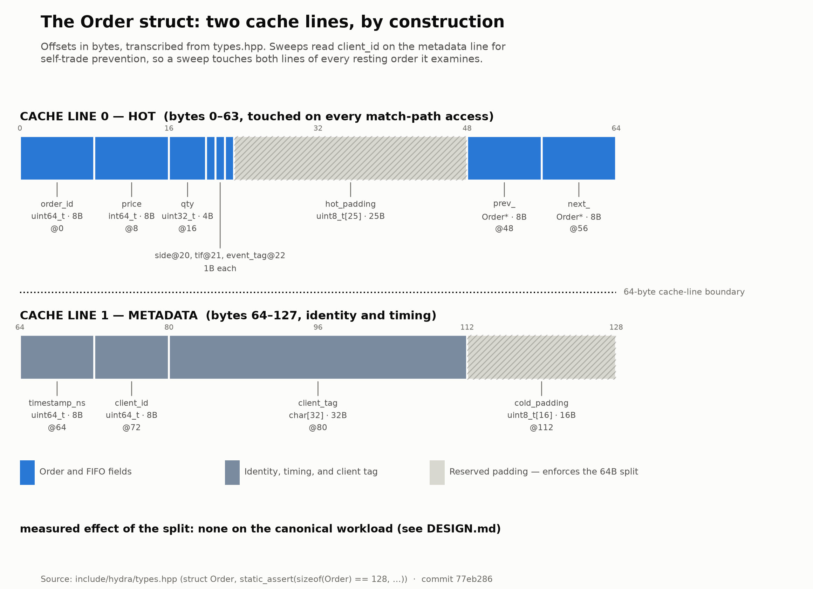
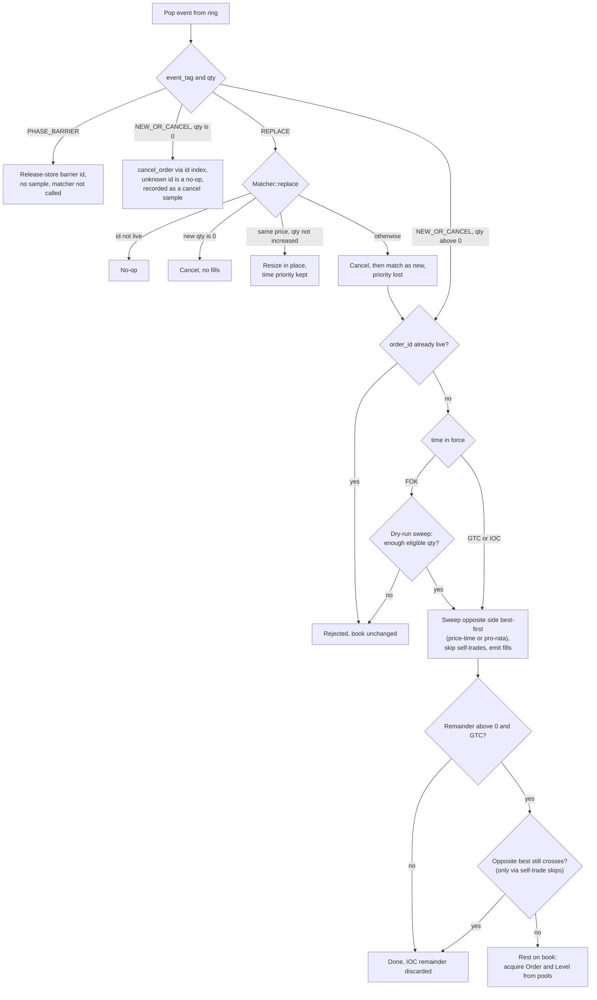

# Architecture

Blitz is a single-instrument limit order book and matching engine (namespace `hydra::`, header-only core in `include/hydra/`).
Two pinned threads share one lock-free ring: the producer pushes events, and the matching thread owns the book, the pools and every fill.
Nothing on the matching path takes a lock or calls the general-purpose allocator.
Results: [README.md](README.md). Timing, validity and statistics: [METHODOLOGY.md](METHODOLOGY.md). Evidence per design choice: [DESIGN.md](DESIGN.md).

## Components

| Component | File | Responsibility | Why it is fast |
|---|---|---|---|
| `SpscQueue<Order,N>` (specialization) | `spsc_queue.hpp` | Producer-to-matcher ring, `N = 65,536`, one 64-byte slot per event with its own sequence word; serves both `Order` layouts (production 128 B, flat-layout ablation 88 B) | The consumer polls the same cache line that carries the data: one cross-core transfer per event, and a 4 MiB ring instead of 8 MiB |
| `SpscQueue<T,N>` (generic) | `spsc_queue.hpp` | Index-based ring for any other trivially copyable payload (used by the unit tests) | One writer per index, release/acquire only, no CAS |
| `ObjectPool<T,N>` | `object_pool.hpp` | Fixed slab with intrusive free list: `Order` (65,536) and `Level` (4,096) | `acquire`/`release` are pointer swaps on a non-atomic list |
| `OrderBook` | `order_book.hpp` | `std::pmr::map` of price to `Level` per side, FIFO of `Order*` per level, `order_id` hash index | Cancel is an index lookup plus a doubly-linked unlink, independent of book depth |
| Size-class free-list resource | `order_book.hpp` | Memory resource behind the book's map and hash nodes | A pop or push on a LIFO list (about 10 instructions) replaced `std::pmr::unsynchronized_pool_resource` (about 150 or more) |
| `Matcher` | `matcher.hpp` | Price-time or pro-rata sweep, GTC/IOC/FOK, self-trade skip, replace | Templated on the fill callback (no `std::function`), no allocation in the sweep |
| Thread bodies | `src/pipeline.cpp` | `matching_thread_fn` (pop, dispatch, record) and `rx_thread_fn` (synthetic generator, live smoke test only) | Each thread pins itself and verifies the mask before looping |
| Benchmark harness | `src/benchmark.cpp` | Preflight, paced replay producer, phase barriers, per-trial stats, validity gate, CSV/JSON | Off the hot path, except that its timestamps are inside the timed window |
| Clock | `clock.hpp` | Serialized `RDTSCP` timestamps, calibrated once against `steady_clock` | A fenced register read, not a syscall (about 30 ns per stamp, counted in the results) |

## Threading and ownership

| Thing | Owner | Rule | Why |
|---|---|---|---|
| Book, `Matcher`, both pools | Matching thread (core 5, `MATCHING_CORE_ID`) | Only this thread touches them | Pool free lists are plain pointers, valid only under single ownership |
| Producer | Core 4 (`RX_CORE_ID`): the harness thread in benchmark mode, `rx_thread_fn` in live mode | Stamps `timestamp_ns` (t1) just before `push()` | The ring is the only path by which event data crosses threads |
| Ring indices | Producer owns `tail_` and `cached_head_`, consumer owns `head_` | Each side writes only its own line and keeps a private copy of the peer's last index | The peer's line is read across cores only when the ring looks full (producer) |
| Ring slot | Slot `seq` is `tail + 1` once the payload is complete | Producer release-stores `seq`, consumer acquire-loads it, then releases `head_` | No separate "ready" index to chase, and each lap publishes a distinct value |
| Shared pipeline state | `stop_token`, `ns_per_cycle` (written before threads start), startup states, sample-sink pointer, phase-barrier ack | Everything else is thread-local | A failed affinity setup is reported to the caller instead of hanging |

Both threads busy-poll (the matcher retries `pop()` up to 1,000 times per outer iteration and never sleeps), so each holds a core at full utilisation.
`pin_to_core` plus `verify_affinity` require the mask to be exactly one core.
Worker startup states (`NOT_STARTED`, `STARTING`, `READY`, `FAILED`): the benchmark waits for the matching thread and throws if it reports `FAILED`.
Fills go to a synchronous callback as stack-local `FillEvent` values, valid until it returns. `MatchingMode` is a runtime setting.

## Data layout

| Type | Size | Layout | Source |
|---|---|---|---|
| `Order` | 128 B, `alignas(64)` | Line 0: `order_id` 0, `price` 8, `qty` 16, `side` 20, `tif` 21, `event_tag` 22, padding 23-47, `prev_` 48, `next_` 56. Line 1: `timestamp_ns` 64, `client_id` 72, `client_tag[32]` 80, padding 112-127 | `types.hpp` |
| Ring slot | 64 B, `alignas(64)` | `seq`, `order_id`, `price`, `timestamp_ns`, `client_id`, `qty`, `side`, `tif`, `event_tag` | `spsc_queue.hpp` |
| `Level` | 64 B, `alignas(64)` | `price`, `total_qty` (`uint64_t`), `order_count`, `head_`, `tail_` | `types.hpp` |
| `FillEvent` | 40 B | `maker_order_id`, `taker_order_id`, `price`, `timestamp_ns`, `qty` | `types.hpp` |

- Sizes, alignment and trivial copyability are `static_assert`ed, so `Order` can cross the ring by value. Prices are `int64_t` ticks, quantities `uint32_t`.
- The ring slot carries only what the matcher reads. `prev_`, `next_`, `client_tag` and padding are not transported and come back zeroed (`client_tag` is read only by `Matcher::replace`, from the resting order). `static_assert`s on field offsets fail the build if `Order` gains a field the slot does not carry, and any layout other than the 128 B and 88 B ones is rejected at compile time.
- `Level::total_qty` is 64-bit because many `uint32_t` quantities can sum past 2^32.
- Ablation builds (`ablation/<variant>/include/hydra/`) shadow single headers so that each arm changes one thing: the flat-layout arm keeps the same ring (same eight transported fields, different offsets), and the mutex arm queues the same eight-field payload through `std::mutex` plus `std::queue`, so it differs from the ring only in synchronisation, not in bytes copied.
- Why two lines: sweep fields and FIFO links share line 0, identity and timing sit on line 1. Honest result: sweeps also read `client_id` (line 1) for the self-trade check, so line 1 is not cold, and the measured benefit of the split is none (flat 88 B layout through the same ring: NO_MEASURABLE_EFFECT at every percentile, see the README ablation table and [DESIGN.md](DESIGN.md)). It is a memory-footprint argument that this workload cannot exercise.

The image was checked against `types.hpp` offsets for this revision. Re-check it if the struct changes.

## Handling one event

`matching_thread_fn` pops an event and dispatches on `event_tag` and `qty`.
Barriers are acknowledged in queue order and never reach the matcher. A cancel goes straight to the book. A replace calls `Matcher::replace` with the replacement event timestamp. Everything else calls `Matcher::match`.

Every non-barrier event then records one sample (arrival stamp to match end) if the benchmark's sink is attached.

| Rule | Behaviour | Why |
|---|---|---|
| Price-time | Best price first, FIFO within a level | Standard priority |
| Pro-rata | Per level: floor share of eligible resting quantity (64-bit intermediates), integer remainder to the largest order up to its headroom, then any leftover in FIFO order | Shares sum exactly to the level fill |
| Time in force | GTC rests its remainder, IOC discards it, FOK runs a side-effect-free dry-run sweep and rejects unless fully fillable | A rejected FOK must leave the book untouched |
| Self-trade | A resting order with the same `client_id` is skipped and the sweep continues, neither side is cancelled. A GTC remainder that would still cross after skipping is discarded, never rested | The book is never left crossed |
| Replace | Unknown id: no-op. New qty 0: cancel. Same price and qty not increased: resize in place, priority kept. Otherwise cancel and re-match as new, priority lost | Only a same-price size reduction is safe to keep in the queue |
| Duplicate id | A new order whose `order_id` is already live is rejected, checked before the FOK dry run | The index maps one id to one resting order |
| Filled maker | Quantity is updated, then the order is cancelled through the normal index path | One removal path keeps level totals and counts consistent |

## Memory and allocation model

| Memory | Size | Source | Why |
|---|---|---|---|
| Order slab | 65,536 x 128 B = 8 MiB | `ObjectPool` inline slab, heap-allocated once at startup | Contiguous, no per-order allocation |
| Level slab | 4,096 x 64 B = 256 KiB | `ObjectPool` inline slab | Same |
| SPSC ring | 65,536 x 64 B = 4 MiB | Inline array in the queue object | One slot per event; the generic ring would be 8 MiB |
| Book arenas | about 3.8 MB (hash index) and 256 KiB (price maps), inside `OrderBook` | `monotonic_buffer_resource` carved into 16-byte size classes (up to 64 B) with LIFO free lists | A freed node is reused immediately, still cache-warm. The hash index is reserved up front |
| Heap fallback | none expected | `InstrumentedFallbackResource` | If an arena overflows, the allocation succeeds from the heap and `arena_fallback_count()` increments, so a heap touch is visible rather than silent |

Pools are not general concurrent allocators: `acquire`, `release` and `reset` belong to the matching thread. Between trials the benchmark resets the book and pools while the matching thread is idle.
The harness allocates and pre-touches its sample storage before each measured window, so page faults do not land inside it.

## Failure modes

| Condition | Detection | Response |
|---|---|---|
| Order or level pool exhausted | `acquire()` returns `nullptr`, `exhaustion_count()` increments | The remainder is not rested, no crash. The benchmark run is invalid |
| Book arena exhausted | `arena_fallback_count()` increments | Allocation succeeds from the heap. The benchmark run is invalid |
| Ring full | `push()` returns `false` | Producer retries up to 1,000 times, then drops the event and counts it. Any drop invalidates a benchmark run |
| Duplicate live `order_id` | Index lookup at the top of `Matcher::match` | Rejected, book unchanged |
| Cancel or replace of an unknown id | Index miss | No-op. Cancelling an already filled order is normal |
| FOK not fully fillable | Dry-run sweep | Rejected with no fills and no book change |
| Malformed dataset or generator parameters | Magic, version, size and enum checks on load, parameter checks in the generator | Throws before any thread starts |
| Unreliable TSC | Calibration sees a core migration or two estimates differing by more than 0.5% | Timestamps fall back to `steady_clock`, the run is recorded as invalid |
| Affinity not honoured | `verify_affinity` finds the mask is not exactly one core | Throws. A worker reports `FAILED` and exits, and the benchmark aborts instead of hanging |
| Untuned host (benchmark only) | Preflight: isolation, `performance` governor, no SMT sibling on both cores | The benchmark refuses to start ([validity gate](METHODOLOGY.md#validity-gate)) |

## Scope

Single instrument, `BUY`/`SELL` limit orders with GTC/IOC/FOK, cancel and replace. No market or stop orders, no multi-instrument support, no feed handler and no network ingress.
Events enter from a seeded binary dataset (`tools/gen_dataset.cpp`) or the synthetic live generator. Fills go to a callback and are not published anywhere.
Matching correctness rests on the unit tests and a determinism fingerprint, not on an independent reference matcher.
