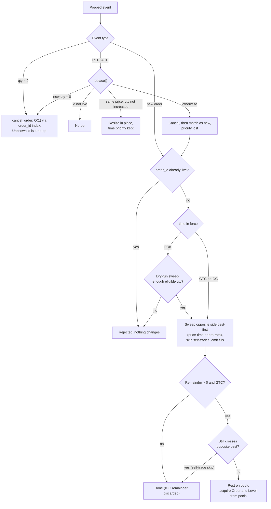

# Architecture

Blitz is a single-instrument limit order book and matching engine (namespace `hydra::`, header-only core in
`include/hydra/`). Two pinned threads are connected by one lock-free ring: a producer pushes 128-byte `Order`
values, and a matching thread owns the book, the pools and every fill. Nothing on the matching path takes a
lock or calls the general-purpose allocator. This page owns components, ownership, layout, event rules and
failure modes. Results are in [`README.md`](README.md), timing and validity in
[`METHODOLOGY.md`](METHODOLOGY.md), evidence for each choice in [`DESIGN.md`](DESIGN.md).

## Components

| Component | File | Responsibility | Why it is fast |
|---|---|---|---|
| `SpscQueue<T,N>` | `include/hydra/spsc_queue.hpp` | Producer-to-matcher ring, `N = SPSC_CAPACITY = 65536` | One writer per index: relaxed own load, acquire other load, release store. No CAS, no lock. |
| `ObjectPool<T,N>` | `include/hydra/object_pool.hpp` | Fixed slab with intrusive free list for `Order` (65,536) and `Level` (4,096) | `acquire`/`release` are pointer swaps on a non-atomic list. |
| `OrderBook` | `include/hydra/order_book.hpp` | `pmr::map` of price to `Level` per side, FIFO of `Order*` per level, `order_id` hash index | Cancel is an index lookup plus a doubly-linked unlink, independent of book depth. |
| `Matcher` | `include/hydra/matcher.hpp` | Price-time or pro-rata sweep, GTC/IOC/FOK, self-trade skip, replace | Templated on the fill callback (no `std::function`). No allocation on the sweep. |
| Thread bodies | `src/pipeline.cpp` | `matching_thread_fn` (pop, dispatch, record) and `rx_thread_fn` (synthetic generator, live smoke test only) | Each thread pins itself and checks the mask before looping. |
| Benchmark harness | `src/benchmark.cpp` | Preflight, open-loop dataset replay as producer, per-trial stats, validity gate, CSV/JSON | Not on the hot path. |
| Clock | `include/hydra/clock.hpp` | Serialized `RDTSCP` timestamps, calibrated against `steady_clock` | A fenced register read rather than a syscall. |

## Threading and ownership

| Thing | Owner | Rule | Why |
|---|---|---|---|
| Book, `Matcher`, both pools | Matching thread (core 5, `MATCHING_CORE_ID`) | Only this thread mutates them. | Pool free lists are plain pointers, valid only under single ownership. |
| `tail_` / `head_` of the ring | Producer / matcher | Each side writes only its own index, publishes with release, reads the other with acquire. | No CAS loop, and the element copy is ordered before its index. |
| Producer | Core 4 (`RX_CORE_ID`): the harness thread in benchmark mode, `rx_thread_fn` in live mode | Stamps `Order.timestamp_ns` just before `push()`. | The ring is the only path by which order data crosses threads. |
| `buffer_`, `tail_`, `head_` | Each `alignas(64)` | Separate cache lines. | The two threads do not false-share. |
| Pipeline state shared across threads | `std::stop_token`, `ns_per_cycle` (written once before threads start), `raw_samples` (atomic pointer) | Everything else is thread-local. | `ns_per_cycle` is calibrated once so cross-thread timestamp subtraction is consistent. |

Both threads busy-poll (the matcher retries `pop()` up to 1,000 times per outer iteration and never sleeps), so
each holds a core at full utilisation. `pin_to_core` plus `verify_affinity` require the mask to be exactly one
core. Core IDs 4/5 are development-host defaults; change them in `include/hydra/config.hpp`.
Fills are delivered to a synchronous callback as stack-local `FillEvent` values, valid only until it returns.
`MatchingMode` (price-time or pro-rata) is a runtime setting.

## Data layout

| Type | Size | Layout | Source |
|---|---|---|---|
| `Order` | 128 B, `alignas(64)` | Line 0: `order_id`, `price`, `qty`, `side`, `tif`, `event_tag`, `prev_`, `next_`. Line 1: `timestamp_ns`, `client_id`, `client_tag[32]`. Explicit padding fills both lines. | `types.hpp` |
| `Level` | 64 B, `alignas(64)` | `price`, `total_qty` (`uint64_t`), `order_count`, `head_`, `tail_` | `types.hpp` |
| `FillEvent` | 40 B | `maker_order_id`, `taker_order_id`, `price`, `timestamp_ns`, `qty` | `types.hpp` |

- Sizes, alignment and trivial copyability are `static_assert`ed, so `Order` can cross the ring by value.
- Why two lines: the fields the sweep reads and the FIFO links share line 0, and identity and timing metadata
  sit on line 1. The matcher also reads `client_id` (line 1) for self-trade checks, so line 1 is not cold.
- `Level::total_qty` is 64-bit because many `uint32_t` quantities can sum past 2^32.
- Prices are `int64_t` ticks, quantities `uint32_t`. Whether the split helps is a [`DESIGN.md`](DESIGN.md) question.

The image is transcribed by hand from `types.hpp` (checked against it for this revision). Re-check it if the
struct changes.

## Handling one event

`matching_thread_fn` pops an `Order` and dispatches on `event_tag` and `qty`. A cancel goes straight to the book.
A replace calls `Matcher::replace`. Everything else calls `Matcher::match`.

| Rule | Behaviour | Why |
|---|---|---|
| Price-time | Best price first, FIFO within a level. | Standard priority. |
| Pro-rata | Per level: floor share of eligible resting quantity (64-bit intermediates), integer remainder to the largest order up to its headroom, then any leftover in FIFO order. | Shares sum exactly to the level fill. |
| Time in force | GTC rests its remainder. IOC discards it. FOK runs a side-effect-free dry-run scan and rejects unless fully fillable. | A rejected FOK must leave the book untouched. |
| Self-trade | A resting order with the same `client_id` is skipped and the sweep continues. Neither side is cancelled. A GTC remainder that would still cross after skipping is discarded, never rested. | The book is never left crossed. |
| Replace | Unknown id: no-op. New qty 0: cancel. Same price and qty not increased: resize in place, priority kept. Otherwise cancel and re-match as new, priority lost. | Only a size reduction at the same price is safe to keep in queue. |
| Duplicate id | A new order whose `order_id` is already live is rejected (checked before FOK). | The index maps one id to one resting order. |
| Fully filled maker | Quantity is updated, then the order is cancelled through the normal index path. | One removal path keeps level totals and counts consistent. |

## Memory and allocation model

- `Order` and `Level` live in inline slabs (`alignas(64)`, about 8 MiB and 256 KiB at the configured sizes), so
  pool objects are contiguous and never touch the heap.
- The book's `pmr::map`s and `order_id` index draw from fixed arenas inside `OrderBook`
  (`pmr::monotonic_buffer_resource` under an `unsynchronized_pool_resource`), sized from `ORDER_POOL_SIZE` and
  `LEVEL_POOL_SIZE`. The index is reserved up front.
- If an arena overflows, `InstrumentedFallbackResource` serves it from the heap and counts it
  (`arena_fallback_count()`), so a heap touch on the hot path is visible rather than silent.
- Pools are not general concurrent allocators: `acquire`, `release` and `reset` belong to the matching thread.

## Failure modes

| Condition | Detection | Response |
|---|---|---|
| Order or level pool exhausted | `acquire()` returns `nullptr`, `exhaustion_count()` increments | `add_order` returns `nullptr`, the remainder is not rested. No crash. The benchmark run is invalid. |
| PMR arena exhausted | `arena_fallback_count()` increments | Allocation succeeds from the heap. The benchmark run is invalid. |
| Ring full | `push()` returns `false` | Producer retries up to 1,000 times, then drops the event and counts it. Any drop invalidates a benchmark run. The live generator prints its drop count at shutdown. |
| Duplicate live `order_id` | Index lookup in `Matcher::match` / `add_order` | Rejected, book unchanged. |
| Cancel or replace of an unknown id | Index miss | No-op. A cancel of an already filled order is normal. |
| FOK not fully fillable | Dry-run scan | Rejected with no fills and no book change. |
| Unreliable TSC | Calibration sees a core migration or two estimates differing by more than 0.5% | Timestamps fall back to `steady_clock`. The run is recorded as invalid. |
| Affinity not honoured | `verify_affinity` finds the mask is not exactly one core | Throws. Thread bodies log and exit instead of running unpinned. |
| Untuned host (benchmark only) | Preflight: isolation, `performance` governor, no SMT sibling on both cores | The benchmark refuses to start. See [`METHODOLOGY.md`](METHODOLOGY.md). |

## Scope

Single instrument, `BUY`/`SELL` limit orders with GTC/IOC/FOK, cancel and replace. There are no market or stop
orders, no multi-instrument support, no order-by-order feed handler and no network ingress. Events enter from a
seeded binary dataset (`tools/gen_dataset.cpp`) or the synthetic live generator. Fills go to a callback and are
not published anywhere.
