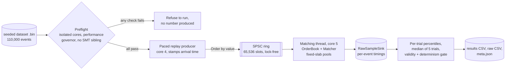

# Blitz Limit Order Book (HYDRA-LOB)


A single-instrument limit order book and matching engine in C++20: price-time and pro-rata matching, GTC/IOC/FOK, cancel, replace, self-trade prevention. A pinned producer thread feeds a pinned matching thread over a lock-free SPSC ring, and the hot path allocates only from fixed pools. A benchmark harness refuses to report latency unless the host is tuned and the run is valid, and four ablation builds measure what each design choice is worth.

> **Status of the numbers.** All figures below were measured at commit `98a597b`. Later matching fixes (self-trade handling and others) changed outcomes, so they describe the earlier engine. The current engine has not been re-measured on a tuned host. The dataset is unchanged (the current generator reproduces hash `51ce6285b274413e`).

## Headline results

Host: i5-1235U, cores 4/5 isolated, `performance` governor, no SMT sibling, one NUMA node, GCC 15.2.0. Workload: `bench_110k.bin` (seed 42, 110,000 events), 5 trials of 10,000 warmup + 100,000 measured events, 85,118 new-order samples per trial. Each cell is the median over trials of that trial's percentile, in ns, from arrival timestamp to match completion.

| Canonical run, `98a597b` | P50 | P99 | P99.9 | P99.99* |
|---|---|---|---|---|
| Price-time | 485 | 1,225 | 1,850 | 8,282 |
| Pro-rata | 491 | 1,425 | 3,132 | 9,708 |

Source: `results/98a597b/{price_time,pro_rata}.csv` (also in [CONSOLIDATED_BENCHMARK_RESULTS.md](CONSOLIDATED_BENCHMARK_RESULTS.md)). *P99.99 is not in the CSVs: it is recomputed from the `.raw.csv` files ([how](METHODOLOGY.md#recomputing-a-percentile-from-raw-samples)) and rests on about 9 tail samples per trial, so it is indicative only.

<p align="center"></p>

What the numbers are not: not network or market-data latency (in-process queue transit plus match time on synthetic data), and not a capacity limit. The 84,992 orders/s in the saved results is the paced offered load (100 kHz events, about 85% new orders). Saturation was not measured.

## How it works



The replay is open loop: events are paced by their arrival offsets, so a slow event does not delay later timestamps. A dropped event or pool overflow invalidates the run instead of being hidden. `./build/blitz_lob` with no flags runs the same threads as a live synthetic smoke test and prints no latency. Components and event handling: [ARCHITECTURE.md](ARCHITECTURE.md).

## What each design choice is worth

Median P99.9 in ns, from `results/98a597b/ablation_summary.md`. The baseline is the ablation suite's own run (1,762 / 3,065), a different run of the same binary from the canonical run above (1,850 / 3,132), so the two are never mixed.

| Choice vs rejected alternative | Price-time | Verdict | Pro-rata | Verdict |
|---|---|---|---|---|
| Lock-free SPSC vs `std::mutex` + `std::queue` | 1,762 to 7,770 (4.41x) | PROVEN | 3,065 to 7,774 (2.54x) | PROVEN |
| Pinning + isolation vs unpinned threads | 1,762 to 9,216 (5.23x) | INCONCLUSIVE | 3,065 to 4,906 (1.60x) | PROVEN |
| Fixed-slab pool vs `new`/`delete` | 1,762 to 6,079 (3.45x) | PROVEN | 3,065 to 6,948 (2.27x) | PROVEN |
| Hot/cold cache-line split vs flat 88 B `Order` | 1,762 to 1,797 (1.02x) | INCONCLUSIVE | 3,065 to 3,554 (1.16x) | INCONCLUSIVE |

Queue and pool effects are clear. The layout effect is smaller than trial noise, and I report it as inconclusive rather than a win. Pinning under price-time is inconclusive because the unpinned median P99 (1,098 ns) is below the pinned one (1,222 ns), yet unpinned per-trial P99.9 ranges 4,729 to 144,646 ns against 1,698 to 1,835 ns pinned. Verdict rule: [METHODOLOGY.md](METHODOLOGY.md#ablation-verdicts). Rationale per choice: [DESIGN.md](DESIGN.md).

## What is verified, and what is not

| Check | Status |
|---|---|
| `ctest`: 9 targets, 71 test cases (layout, clock, pool, SPSC, book, matcher edge cases, pipeline, harness) | 9/9 passed on a clean rebuild of the current tree |
| Sanitizers: ASan+UBSan on pool, matcher, suite tests and `blitz_lob_asan`, TSan on SPSC test and `blitz_lob_tsan` | build targets exist, not re-run on the current tree |
| Run validity: any drop, pool exhaustion, arena fallback, clock fallback, or dirty tree invalidates a run | all 70 measured trials (14 runs x 5) valid, 0 drops |
| Determinism: `state_hash` identical across trials | holds in all 14 runs, but it is a repeatability fingerprint, not a correctness oracle |
| Reference validation against an independent matcher | not done (`reference_validation_status=NOT_RUN` in every summary CSV) |
| CI (`.github/workflows/format.yml`) | formatting only (clang-format, black), builds and tests nothing |

## Quick start

Needs Linux x86-64 (RDTSCP clock), a C++20 compiler (GCC 15.2 used), CMake 3.20+. The benchmark also needs `numactl` and a tuned host (steps in [ALL_COMMANDS.md](ALL_COMMANDS.md)), otherwise preflight refuses.

```bash
cmake -S . -B build -DCMAKE_BUILD_TYPE=Release
cmake --build build -j"$(nproc)"
ctest --test-dir build --output-on-failure
./build/blitz_gen_dataset --seed 42 --count 110000 --output datasets/bench_110k.bin

mkdir -p "results/$(git rev-parse --short HEAD)"
numactl --cpunodebind=0 --membind=0 -- ./build/blitz_lob --benchmark --mode price_time --trials 5 \
    --dataset datasets/bench_110k.bin --output "results/$(git rev-parse --short HEAD)/price_time.csv"

./scripts/run_ablations.sh --trials 5     # builds the variants, runs both modes (10 runs)
```

Core IDs 4/5 are constants in `include/hydra/config.hpp`: pick two cores without an SMT sibling on other hardware. Fewer than 5 trials is marked a smoketest, and a dirty tree invalidates a run unless `--allow-dirty` is passed.

## Limits

- Figures predate the matching fixes (see banner). No tuned-host re-measure of the current engine exists.
- `results/` and `*.csv` are gitignored: the evidence is kept locally, and a fresh clone has only the charts and `CONSOLIDATED_BENCHMARK_RESULTS.md`.
- Latency is in-process queue transit plus match time on synthetic data. Throughput is offered load, not capacity.
- Preflight checks per-core isolation, governor, and SMT sibling only. NUMA binding, IRQ placement, `nohz_full`, `rcu_nocbs`, and background load are the operator's job.
- One x86-64 Linux host (a hybrid i5-1235U), one session, 5 trials per verdict. The dataset has no REPLACE events, so replace is not benchmarked.

## Repository map

```
include/hydra/   header-only engine (types, spsc_queue, object_pool, order_book, matcher, ...)
src/             main.cpp (CLI), pipeline.cpp (thread bodies), benchmark.cpp (harness)
tools/           gen_dataset.cpp      ablation/  one shadowed header per ablation build
tests/           9 C++ tests + test_chart_reporting.py      scripts/  run_ablations.sh, format.sh
charts/          generate_charts.py and PNGs      datasets/  manifest.txt (data gitignored)
```

Docs: [ARCHITECTURE](ARCHITECTURE.md) (components, data layout, event rules, failure modes), [METHODOLOGY](METHODOLOGY.md) (timing, statistics, validity gate), [DESIGN](DESIGN.md), [ALL_COMMANDS](ALL_COMMANDS.md), [CONSOLIDATED_BENCHMARK_RESULTS](CONSOLIDATED_BENCHMARK_RESULTS.md). License: MIT, see [LICENSE](LICENSE).
