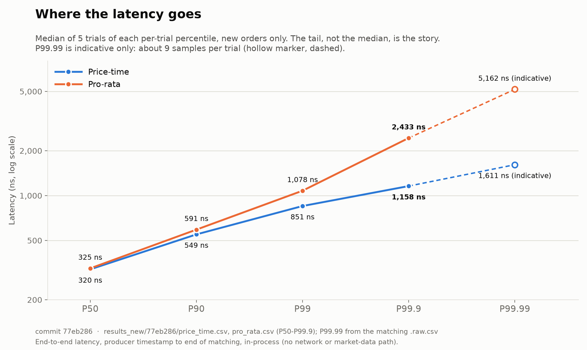
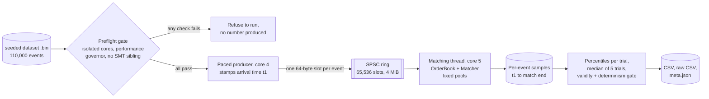
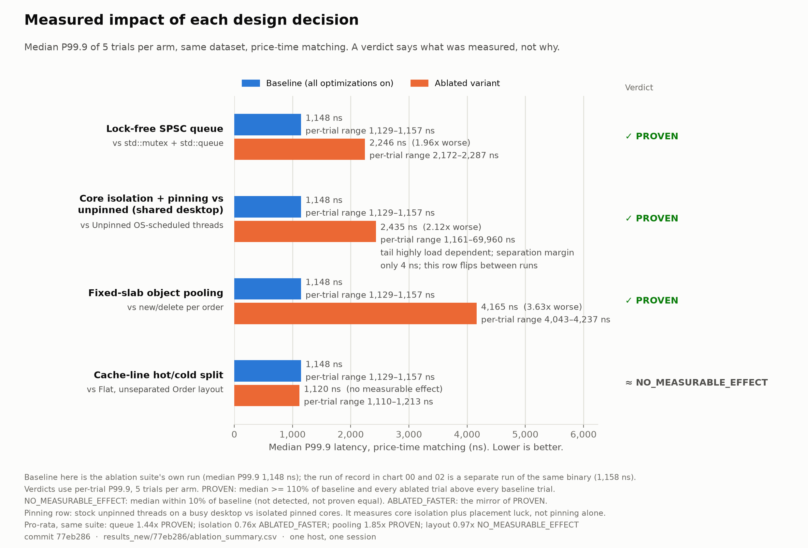

# Blitz Limit Order Book (HYDRA-LOB)


A low-latency limit order book and matching engine in C++20, with a benchmark harness that only reports a latency number when the host is tuned and the run is valid.

## What it is

| | |
|---|---|
| **What** | A single-instrument limit order book and matching engine |
| **Matching rules** | Price-time (FIFO) and pro-rata |
| **Order handling** | GTC, IOC and FOK orders, cancel, replace, self-trade prevention |
| **Architecture** | Pinned producer thread, lock-free ring of 64-byte slots, pinned matching thread; fixed memory pools, no allocation on the hot path |
| **Measurement** | A harness that refuses to run on an untuned host, plus four ablation builds that measure what each design choice is worth |

> **Status.** Commit `77eb286`, clean tree, run on 2026-11-12. Host: Intel i5-1235U (hybrid), cores 4 and 5 on an isolated E-core cluster (`isolcpus=4-7 nohz_full=4-7 rcu_nocbs=4-7`), whole cluster tuned with `sudo scripts/tune_host.sh 4,5,6,7`. Every number below comes from that one run.

## Results at a glance

Latency = time from the producer's timestamp to the end of matching, in nanoseconds (in-process, not network). Each cell is the median of 5 trials of that trial's percentile.

| Percentile | What it means | Price-time | Pro-rata |
|---|---|---|---|
| **P50** | Half of all orders are matched at least this fast | **320 ns** | **325 ns** |
| **P90** | 9 in 10 orders | 549 ns | 591 ns |
| **P99** | 99 in 100 orders | 851 ns | 1,078 ns |
| **P99.9** | 999 in 1,000 orders (the tail) | 1,158 ns | 2,433 ns |
| P99.99 | Indicative only: about 9 samples per trial | 1,611 ns | 5,162 ns |

| Run conditions | |
|---|---|
| Workload | `datasets/bench_110k.bin` (seed 42): 110,000 events, 10,000 warm-up and 100,000 measured per trial, 85,118 new-order samples per trial |
| Quality checks | All runs VALID, STABLE (P99.9 variation 2.3% and 2.8%), determinism PASS, 0 dropped events |
| Repeatability | The same engine code measured three times on the tuned host agrees within about 2% (3% at pro-rata P99.9) |
| Source | `results_new/77eb286/` and [CONSOLIDATED_BENCHMARK_RESULTS.md](CONSOLIDATED_BENCHMARK_RESULTS.md); P99.99 recipe in [METHODOLOGY.md](METHODOLOGY.md#recomputing-a-percentile-from-raw-samples) |

<p align="center"></p>

## How it works



| Stage | What happens | Code |
|---|---|---|
| 1. Dataset | A seeded generator writes the events and their arrival times | `tools/gen_dataset.cpp` |
| 2. Preflight | Refuses to run unless the cores are isolated, the governor is `performance` and there is no SMT sibling | `src/benchmark.cpp` |
| 3. Producer | Replays events at their recorded pace and stamps each with `t1` | `src/benchmark.cpp` |
| 4. Ring | Lock-free single-producer single-consumer queue, one 64-byte slot per event | `include/hydra/spsc_queue.hpp` |
| 5. Matcher | Order book plus price-time or pro-rata matching, memory from fixed pools | `include/hydra/order_book.hpp`, `matcher.hpp` |
| 6. Samples | Per-event timings become percentiles per trial, then the median of 5 trials | `include/hydra/stats.hpp` |
| 7. Gate | A dropped event, pool overflow or non-deterministic result invalidates the run | `src/benchmark.cpp` |

Replay is open loop: events keep their recorded arrival times, so a slow event does not delay later ones. Details: [ARCHITECTURE.md](ARCHITECTURE.md) (components and event rules) and [METHODOLOGY.md](METHODOLOGY.md) (timing and statistics).

## What each design choice is worth

Each ablation swaps in one alternative and re-measures on the same dataset. Numbers are median P99.9 in ns, "ours to alternative". The ablation baseline (1,148 and 2,343) is a separate run of the same binary from the headline run above.

| Design choice | Alternative tested | Price-time | Pro-rata | Verdict | What it means |
|---|---|---|---|---|---|
| Lock-free SPSC ring | `std::mutex` + `std::queue` | 1,148 to 2,246 (1.96x) | 2,343 to 3,363 (1.44x) | PROVEN, PROVEN | Clearly better; the median is also 2.7x lower (320 vs 861 ns) |
| Fixed memory pools | `new` / `delete` per order | 1,148 to 4,165 (3.63x) | 2,343 to 4,330 (1.85x) | PROVEN, PROVEN | Allocating on the hot path costs the tail |
| Hot/cold cache-line split | Flat 88-byte `Order` | 1,148 to 1,120 (0.98x) | 2,343 to 2,268 (0.97x) | NO_MEASURABLE_EFFECT | No effect at any percentile: this workload cannot exercise it ([DESIGN.md](DESIGN.md)) |
| Core isolation + pinning | Unpinned threads on the shared desktop | 1,148 to 2,435 (2.12x) | 2,343 to 1,782 (0.76x) | PROVEN by 4 ns, ABLATED_FASTER | **Not a pinning result.** The row flips between sessions |

| Verdict | Meaning (rule: [METHODOLOGY.md](METHODOLOGY.md#ablation-verdicts)) |
|---|---|
| PROVEN | Median at least 10% worse and every alternative trial worse than every baseline trial |
| NO_MEASURABLE_EFFECT | Medians within 10% (not detected, not proven equal) |
| ABLATED_FASTER | The mirror of PROVEN: the alternative was faster |
| INCONCLUSIVE | A clear gap in the medians, but the trial ranges overlap |

**Why the last row is not about pinning.** Across four sessions it has read INCONCLUSIVE, ABLATED_FASTER and PROVEN. Here price-time is PROVEN only because the fastest unpinned trial (1,161 ns) beat the slowest baseline trial (1,157 ns) by 4 ns, and unpinned trials ranged from 1,161 to 69,960 ns; pro-rata was faster unpinned. It measures core isolation plus placement luck on a busy desktop. Earlier one-off runs showed pinning alone had no measurable effect once the core set was fixed (not reproducible from repo scripts).

<p align="center"></p>

## What is verified, and what is not

| Check | Status |
|---|---|
| Unit and integration tests | 10 `ctest` targets, 80 test functions: 10/10 pass on a fresh build; pool, SPSC, matcher and suite tests also build with ASan/UBSan or TSan |
| Verdict rule | C++ and Python implementations share a 53-case fixture; both pass |
| Run validity | A drop, pool exhaustion, arena fallback, clock fallback or dirty tree invalidates a run; all 12 runs (2 headline + 10 ablation) VALID |
| Determinism | `state_hash` identical across trials; a repeatability fingerprint, not a correctness oracle |
| Full-pipeline sanitizer binaries | `blitz_lob_asan` and `blitz_lob_tsan` build, but were not re-run on this commit |
| Independent reference matcher | Not done (`reference_validation_status=NOT_RUN` in every CSV) |
| CI | Formatting only (`clang-format`, `black`); it runs no tests |

## Quick start

Linux x86-64 (RDTSCP clock), a C++20 compiler (GCC 15.2 used), CMake 3.20+, `numactl`. Benchmarks need the tuned host, otherwise preflight refuses. All commands: [ALL_COMMANDS.md](ALL_COMMANDS.md).

| Step | Command |
|---|---|
| Build (re-run after every commit: the commit stamp is taken here) | `cmake -S . -B build -DCMAKE_BUILD_TYPE=Release && cmake --build build -j"$(nproc)"` |
| Test | `ctest --test-dir build --output-on-failure` |
| Generate the dataset | `./build/blitz_gen_dataset --seed 42 --count 110000 --output datasets/bench_110k.bin` |
| Tune the host after every reboot (needs sudo; boot parameters `isolcpus=4-7 nohz_full=4-7 rcu_nocbs=4-7`) | `sudo scripts/tune_host.sh 4,5,6,7` |
| Run the ablation suite (baseline + 4 variants, both modes: 10 runs) | `./scripts/run_ablations.sh --trials 5` |

```bash
# One canonical run (the benchmark pins itself to the configured cores, so run it under numactl)
commit="$(git rev-parse --short HEAD)"; mkdir -p "results/$commit"
numactl --cpunodebind=0 --membind=0 -- ./build/blitz_lob --benchmark --mode price_time --trials 5 \
    --dataset datasets/bench_110k.bin --output "results/$commit/price_time.csv"
```

Cores 4 and 5 are constants in `include/hydra/config.hpp`; on other hardware choose two cores without an SMT sibling. Fewer than 5 trials is marked a smoketest, and a dirty tree invalidates a run unless `--allow-dirty` is passed.

## Limits

| Limit | Detail |
|---|---|
| One host, one session | 5 trials per verdict, no repeat on another day; the same binary's tail can move 10-20% between sessions |
| Synthetic, in-process | Seeded synthetic data; latency is queue transit plus matching, with no network or feed handler |
| Load is not capacity | 85,000 orders/s is the paced offered load; saturation was not tested |
| No replace benchmark | The headline dataset has no REPLACE events: replace is tested but not benchmarked |
| Results are not in git | `results*/` and `*.csv` are gitignored: a fresh clone has the code, charts and [CONSOLIDATED_BENCHMARK_RESULTS.md](CONSOLIDATED_BENCHMARK_RESULTS.md), not the raw data |
| Preflight scope | It checks per-core isolation, governor and SMT sibling only; NUMA binding, IRQ placement, `nohz_full` and background load are the operator's job |

## Repository map

| Path | Contents |
|---|---|
| `include/hydra/` | Header-only engine: types, SPSC queue, object pool, order book, matcher, stats |
| `src/` | `main.cpp` (CLI), `pipeline.cpp` (thread bodies), `benchmark.cpp` (harness) |
| `tools/` | `gen_dataset.cpp`, the dataset generator |
| `ablation/` | One shadowed header set per ablation build |
| `tests/` | 10 C++ test targets and 2 Python test files |
| `scripts/` | `tune_host.sh`, `run_ablations.sh`, `ablation_verdict.py`, `format.sh` |
| `charts/` | `generate_charts.py` and its four PNGs |
| `datasets/` | `manifest.txt` (the data files are gitignored) |

## Documentation

| Document | Read it for |
|---|---|
| [ARCHITECTURE.md](ARCHITECTURE.md) | Components, data layout, event handling, failure modes |
| [METHODOLOGY.md](METHODOLOGY.md) | Timing, statistics, validity gate, verdict rule, [output files](METHODOLOGY.md#output-files) |
| [DESIGN.md](DESIGN.md) | Why each design choice was made and what was measured |
| [CONSOLIDATED_BENCHMARK_RESULTS.md](CONSOLIDATED_BENCHMARK_RESULTS.md) | Every trial of every run |
| [ALL_COMMANDS.md](ALL_COMMANDS.md) | The full, runnable command reference |

License: MIT, see [LICENSE](LICENSE).
