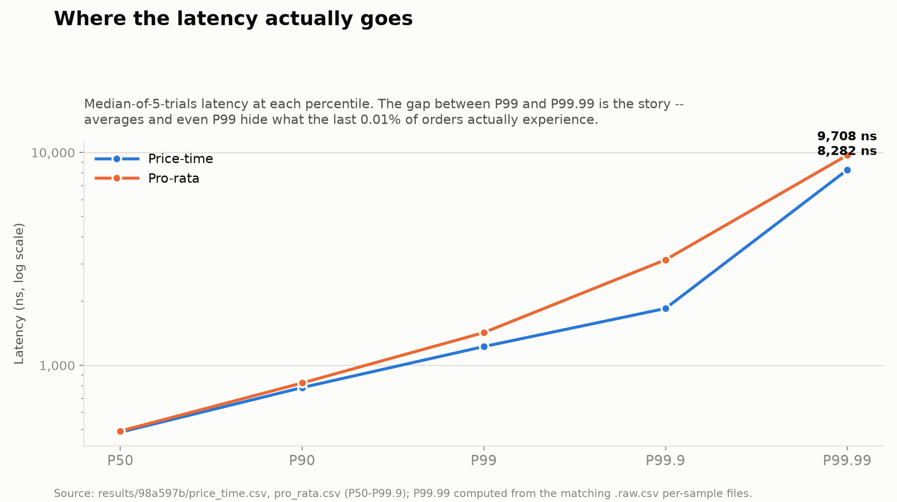
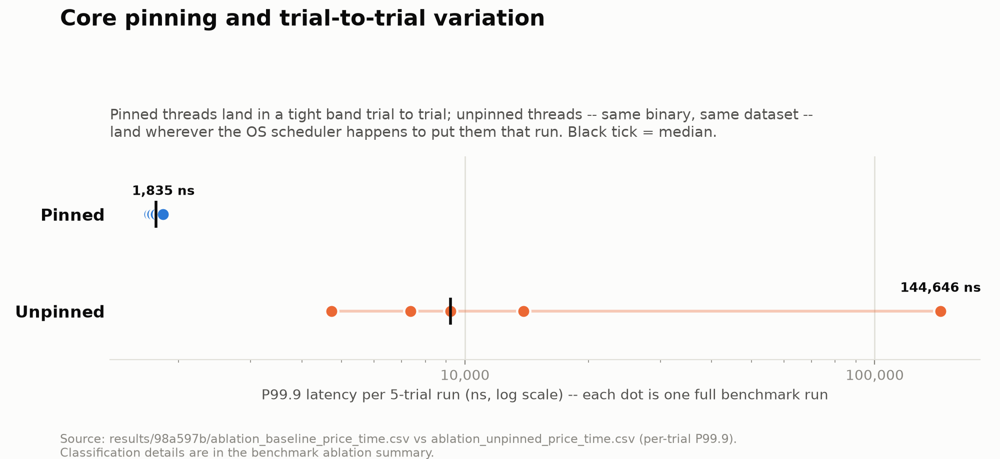
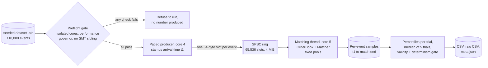
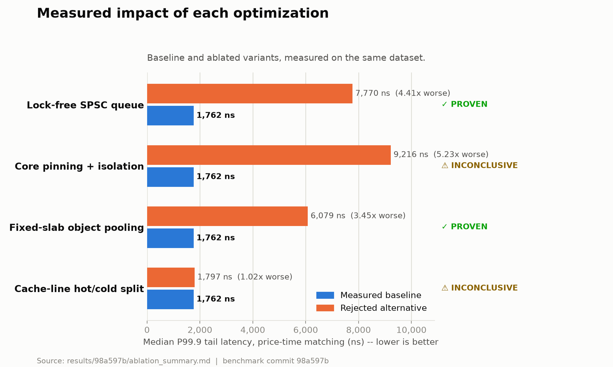

# Blitz Limit Order Book (HYDRA-LOB)


A single-instrument limit order book and matching engine in C++20: price-time and pro-rata matching, GTC/IOC/FOK, cancel, replace, self-trade prevention.
A pinned producer thread feeds a pinned matching thread through a lock-free SPSC ring of 64-byte slots, and the hot path allocates only from fixed pools.
The benchmark harness refuses to report latency unless the host is tuned and the run is valid.
Four ablation builds measure what each design choice is worth, with a verdict rule that can say "no measurable effect".

> **Status.** Commit `77eb286`, clean tree, run on 2026-11-12. Host: i5-1235U (hybrid), cores 4/5 on an isolated E-core cluster (`isolcpus=4-7 nohz_full=4-7 rcu_nocbs=4-7`), whole cluster tuned with `sudo scripts/tune_host.sh 4,5,6,7` (`performance` governor, IRQs moved off). All figures below come from that one run.

## Headline results

`bench_110k.bin` (seed 42): 5 trials of 10,000 warmup + 100,000 measured events, 85,118 new-order samples per trial. Cells are the median over trials of each trial's percentile in ns, from producer timestamp to match completion (in-process, not network). Both runs VALID, STABLE (P99.9 CV 2.3% / 2.8%), determinism PASS, 0 dropped events.

| `77eb286` | P50 | P90 | P99 | P99.9 | P99.99* |
|---|---|---|---|---|---|
| Price-time | 320 | 549 | 851 | 1,158 | 1,611 |
| Pro-rata | 325 | 591 | 1,078 | 2,433 | 5,162 |

Source: `results_new/77eb286/{price_time,pro_rata}.csv`, also in [CONSOLIDATED_BENCHMARK_RESULTS.md](CONSOLIDATED_BENCHMARK_RESULTS.md). *P99.99 rests on about 9 tail samples per trial, so it is indicative only; recompute it from the raw files ([how](METHODOLOGY.md#recomputing-a-percentile-from-raw-samples)).

Versus the earlier engine (`98a597b`), price-time P50 falls 485 to 320 (-34%) and P99.9 1,850 to 1,158 (-37%); pro-rata P99.9 falls 3,132 to 2,433 (-22%). That run was a different session and an older engine, so it is informative, not a controlled A/B. Same-session paired runs of the last three performance commits (not stored in the repo) showed price-time P50 420 to 320 ns. The same engine code was measured three times on the tuned host (including an earlier run in `results_new/`) and agrees within about 2% (3% at pro-rata P99.9), P50 to P99.9.

<p align="center"> </p>

## How it works



Replay is open loop: events are paced by their recorded arrival offsets, and a slow event does not delay later ones. In-band phase barriers make the sample sink attach only after warmup has fully drained and end a trial only after its queue is empty. A dropped event or pool overflow invalidates the run. Running `./build/blitz_lob` with no flags runs the same threads as a live smoke test and prints no latency. Components and event rules: [ARCHITECTURE.md](ARCHITECTURE.md).

## What each design choice is worth

Median P99.9 in ns, same dataset and host; each arm changes one thing (the mutex arm queues the same eight-field payload as the ring, the flat layout uses the same ring). The ablation baseline (1,148 / 2,343) is a separate run of the same binary from the headline run (1,158 / 2,433), so the two are never mixed. Verdict rule: [METHODOLOGY.md](METHODOLOGY.md#ablation-verdicts).

| Choice vs rejected alternative | Price-time | Verdict | Pro-rata | Verdict |
|---|---|---|---|---|
| Lock-free SPSC ring vs `std::mutex` + `std::queue` | 1,148 to 2,246 (1.96x) | PROVEN | 2,343 to 3,363 (1.44x) | PROVEN |
| Fixed pools vs `new`/`delete` per order | 1,148 to 4,165 (3.63x) | PROVEN | 2,343 to 4,330 (1.85x) | PROVEN |
| Core isolation + pinning vs unpinned on the shared desktop | 1,148 to 2,435 (2.12x) | PROVEN, by 4 ns | 2,343 to 1,782 (0.76x) | ABLATED_FASTER |
| Hot/cold cache-line split vs flat 88 B `Order` | 1,148 to 1,120 (0.98x) | NO_MEASURABLE_EFFECT | 2,343 to 2,268 (0.97x) | NO_MEASURABLE_EFFECT |

Queue and pool effects are clear; the mutex queue is also 2.7x worse at P50 (861 vs 320 ns). The isolation row is not a pinning result: across four sessions it has read INCONCLUSIVE, ABLATED_FASTER and PROVEN. Here price-time is PROVEN worse only because the fastest unpinned trial (1,161) beat the slowest baseline trial (1,157) by 4 ns, with unpinned trials spanning 1,161 to 69,960 ns, while pro-rata is faster unpinned. It measures isolation plus placement luck on a busy desktop (earlier one-off runs: roughly 4x to 40x worse tails off the isolated cores, depending on desktop load; pinning alone showed no measurable effect once the core set was fixed; not reproducible from repo scripts). The hot/cold split shows no measurable effect at any percentile (P50 320 vs 320 ns), so it is a footprint argument that this workload cannot exercise (analysis in [DESIGN.md](DESIGN.md)).

<p align="center"></p>

## What is verified, and what is not

| Check | Status |
|---|---|
| `ctest`: 10 targets, 80 test functions (layout, clock, pool, SPSC, book, matcher edge cases, pipeline, harness, verdict rule) | 10/10 passed on a fresh build of `77eb286`. Pool, SPSC, matcher and suite tests are built with ASan/UBSan or TSan |
| Verdict rule: C++ and Python implementations share a 53-case fixture | `phase10_verdict` and `tests/test_verdict_parity.py` both pass |
| Run validity: any drop, pool exhaustion, arena fallback, clock fallback or dirty tree invalidates a run | all 12 runs (2 headline + 10 ablation) VALID, 5 trials each |
| Determinism: `state_hash` identical across trials | holds, but it is a repeatability fingerprint, not a correctness oracle |
| Full-pipeline sanitizer binaries (`blitz_lob_asan`, `blitz_lob_tsan`) | build targets exist, not re-run on this commit |
| Reference validation against an independent matcher | not done (`reference_validation_status=NOT_RUN` in every CSV) |
| CI (`.github/workflows/format.yml`) | formatting only (clang-format, black), runs no tests |

## Quick start

Linux x86-64 (RDTSCP clock), C++20 compiler (GCC 15.2 used), CMake 3.20+, `numactl`. Benchmarks need the tuned host below, otherwise preflight refuses. Details: [ALL_COMMANDS.md](ALL_COMMANDS.md).

```bash
cmake -S . -B build -DCMAKE_BUILD_TYPE=Release     # re-run after every commit: the commit stamp is taken here
cmake --build build -j"$(nproc)"
ctest --test-dir build --output-on-failure
./build/blitz_gen_dataset --seed 42 --count 110000 --output datasets/bench_110k.bin

# Benchmark host: kernel boot parameters isolcpus=4-7 nohz_full=4-7 rcu_nocbs=4-7, then after every reboot:
sudo scripts/tune_host.sh 4,5,6,7                  # governor + EPP, IRQs off cores 4-7, masks power-profiles-daemon
commit="$(git rev-parse --short HEAD)"; mkdir -p "results/$commit"
numactl --cpunodebind=0 --membind=0 -- ./build/blitz_lob --benchmark --mode price_time --trials 5 \
    --dataset datasets/bench_110k.bin --output "results/$commit/price_time.csv"
./scripts/run_ablations.sh --trials 5              # baseline + 4 variants, both modes (10 runs)
```

Cores 4/5 are constants in `include/hydra/config.hpp`: choose two cores without an SMT sibling on other hardware. Fewer than 5 trials is marked a smoketest, and a dirty tree invalidates a run unless `--allow-dirty` is passed.

## Limits

- One host, one session, 5 trials per verdict. No repeat on another day: the same binary's tail can move 10-20% between sessions.
- Synthetic seeded data, in-process latency (queue transit plus match), no network or feed handler. The 85,000 orders/s is paced offered load, not capacity (saturation not tested). The headline dataset has no REPLACE events, so replace is tested but not benchmarked.
- `results*/` and `*.csv` are gitignored: a fresh clone has the code, charts and [CONSOLIDATED_BENCHMARK_RESULTS.md](CONSOLIDATED_BENCHMARK_RESULTS.md), not the raw data.
- Preflight checks per-core isolation, governor and SMT sibling only. NUMA binding, IRQ placement, `nohz_full` and background load are the operator's job.

## Repository map

```
include/hydra/   header-only engine (types, spsc_queue, object_pool, order_book, matcher, stats, ...)
src/             main.cpp (CLI), pipeline.cpp (thread bodies), benchmark.cpp (harness)
tools/           gen_dataset.cpp          ablation/  one shadowed header set per ablation build
tests/           10 C++ tests, 2 Python tests     scripts/  tune_host.sh, run_ablations.sh, ablation_verdict.py
charts/          generate_charts.py and PNGs      datasets/  manifest.txt (data gitignored)
```

Docs: [ARCHITECTURE](ARCHITECTURE.md) (components, data layout, event handling, failure modes), [METHODOLOGY](METHODOLOGY.md) (timing, statistics, validity gate, output files: [#output-files](METHODOLOGY.md#output-files)), [DESIGN](DESIGN.md), [ALL_COMMANDS](ALL_COMMANDS.md), [CONSOLIDATED_BENCHMARK_RESULTS](CONSOLIDATED_BENCHMARK_RESULTS.md). License: MIT, see [LICENSE](LICENSE).
